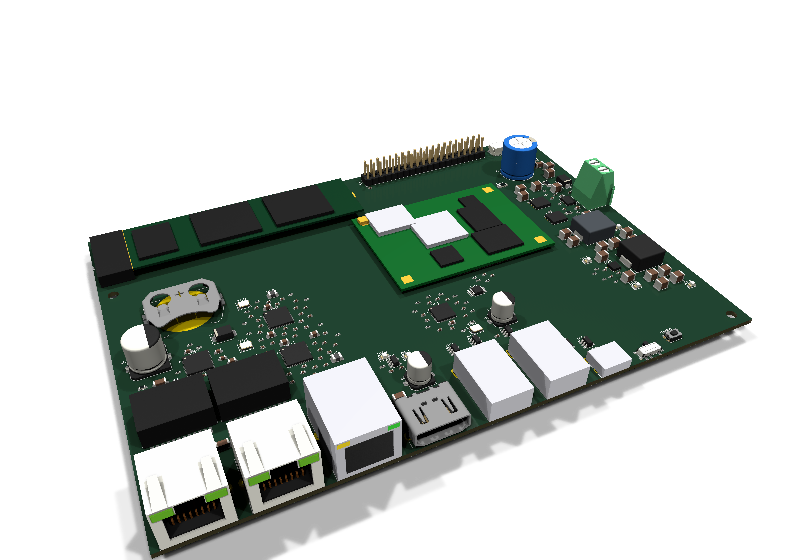

# CM5 載板:概念擺位與 3D 預覽

**這不是正式 PCB。** 只擺件、沒有佈線、沒有跑 DRC,用來在畫正式 PCB 之前先看板子大小、
接頭排在板邊的順序,以及大件彼此擋不擋得到。正式 PCB 之後照其他板子的流程做
(`BoardSpec` 擺件 + 自檢 → freerouting → DRC)。



| 檔案 | 內容 |
|---|---|
| `concept.py` | 讀 `../net.txt`,擺出 221 個元件 → `cm5-concept.kicad_pcb` + `models/*.wrl` |
| `render.ps1` | 用 `kicad-cli pcb render` 出 4 張圖到 `render/` |
| `render/` | 斜前方、板邊接頭、斜後方、正上方 |

```powershell
& "$env:LOCALAPPDATA\Programs\KiCad\10.0\bin\python.exe" concept.py
.\render.ps1
```

## 擺位

170 × 120 mm,4 層。

- **下緣接頭,由左到右**:PoE 網口 ×2(J40/J41)、原生 Gigabit 網口(J30)、HDMI、
  USB-A ×2、USB-C 燒錄口、FLASH/RUN 滑動開關、電源鍵。總共 3 個網口。
- **右緣**:54 V 輸入端子,與 54 V → 5 V、5 V → 3.3 V 兩級降壓。
- **上緣**:M.2 插座與 NVMe 2280 SSD、40-pin GPIO、風扇座。
- **中間**:CM5 模組,底下 40 × 55 mm 不放件(連接器堆疊只有 1.5 mm)。
- **左半**:PoE 變壓器、IP804AR、2 顆 LAN7800、RTC 電池座。
- 被動件依網表找「共用最多小網路」的 IC 或接頭,從旁邊螺旋找第一個空位。
- 固定孔 M3 ×4:左上被 M.2 插座、左下被 PoE 網口佔住,這兩顆往內移到 (4, 31) 與 (4, 99.5)。

## 自檢

寫檔前所有有 courtyard 的件(含固定孔)兩兩比對外接框,有重疊就不寫檔。
把左上固定孔移回板角 (4, 4) 會失敗並列出 `H1-J60`。

## 跟實物不一樣的地方

- **CM5 模組、NVMe SSD 是示意外型**:外框尺寸與 1.5 mm 堆疊高度是對的,上面的晶片位置是隨意畫的。
- **KiCad 10 庫裡沒有 3D 模型的件用方塊代替**:USB-C(HRO)、USB-A(Molex 48037)、
  HR911130A、G2423S、M.2 插座、TPS568230(RJE)、CM5 板對板連接器。
- **用外型相近的檔代替**:RJHSE5380 用 RJHSE538X、QFN-48 EP5.3 用 EP5.15。
- **RJHSE5380 的插孔在封裝局部 −y**,所以 J40/J41 轉 180°。正式 PCB 要用同樣的方向,
  轉錯會讓插孔朝板內。
